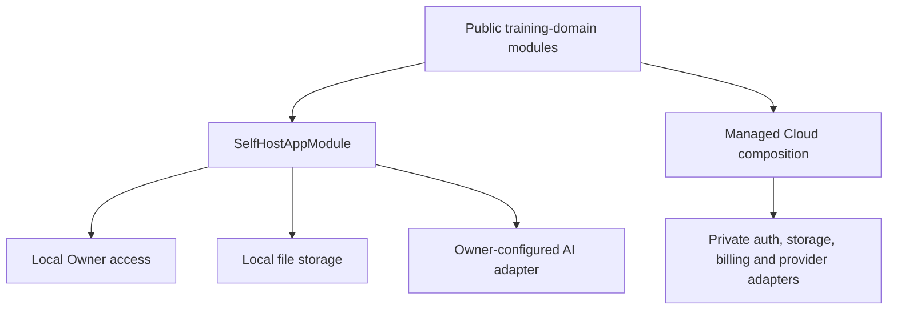
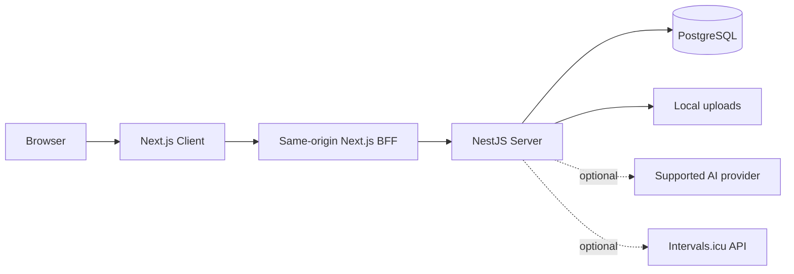

# Architecture

This document describes the public Trainingload.ai core and the contracts that let Self-host and Managed Cloud use the same training-domain implementation without maintaining two copies of it.

## Source ownership

`trainingloadai` is the source of truth for the public Client, Server, Prisma schema, messages, shared contracts, Docs, and Self-host operations. Managed Cloud pins one reviewed public commit and supplies private deployment adapters around its declared boundaries. Public source is never regenerated from a private checkout.

The public repository cannot import billing, membership, AI-credit, commercial operations, private provider, Desktop, or Mobile implementation packages. `pnpm boundary:check` enforces that rule for source and release inputs.

## Runtime composition



The edition is selected by the executable entrypoint. `apps/server/src/main.self-host.ts` loads `SelfHostAppModule`, validates the deployment edition, and defaults `SELF_HOST_MODE` to `core-local`. A Cloud entrypoint must set `DEPLOYMENT_MODE=cloud`; conflicting configuration fails before the application starts.

`AppModule` contains the shared HTTP and training modules. `SelfHostAppModule` adds the local Owner, local AI-operation persistence, local onboarding and account lifecycle, Self-host workers, and supported public integrations. Deployment-specific behavior enters through explicit Nest providers and package exports rather than deep imports.

## Browser and API path



The browser uses one public Client origin. The BFF forwards API requests, cookies, uploads, streaming responses, and cancellation to the Server on the private Compose network. PostgreSQL and the Server are not published as host ports by the supported bundle.

`GET /api/runtime/capabilities` is the runtime contract between Server and Client. The Client uses it to render available features and configuration states. Build-time aliases select the public deployment UI for Self-host; Managed Cloud supplies its overlay during its own isolated build.

## Data and migrations

The public Prisma schema and Self-host migration lineage live in `packages/prisma/core`. A new Self-host database is created only from that lineage. Managed Cloud has its own composed schema, generated Prisma Client, and production migration history.

The two migration histories must never run against the same database. Shared records expose stable scalar identifiers at extension boundaries; private schemas own their commercial relations and migrations.

Uploaded files use the configured local data root. Backups must capture the database, uploads, release metadata, and checksums as one consistent instance snapshot. See [BACKUP_RESTORE.md](BACKUP_RESTORE.md) and [UPGRADE.md](UPGRADE.md).

## Messages and documentation

`packages/messages` is the public message source of truth. Every public locale follows the English catalog, and missing translations fall back to English. A Managed build may deep-merge a private message delta, but duplicate leaves are an error.

`apps/docs` is built and deployed independently. It is not included in the Self-host runtime Compose stack or product images.

## Release isolation

Self-host builds Client, Server, and migration images from one public revision. A release bundle pins exact multi-architecture image digests and records provenance, SBOMs, checksums, and signatures. The bundle is upgraded as a unit.

Managed Cloud records both its private revision and the pinned public revision, plus the migration head and image digests. Its install directories, Prisma output, Next output, and caches remain separate from the public checkout.

## Architectural checks

Before changing a boundary, run the focused tests and these repository checks:

```bash
pnpm boundary:check
pnpm messages:check
pnpm selfhost:inventory:check
pnpm selfhost:docs-contract
pnpm build:selfhost
pnpm test:selfhost
```

Changes to Compose, image inputs, migrations, runtime capabilities, package exports, or message composition are architecture changes and should explain both Self-host and Managed Cloud impact in the pull request.
