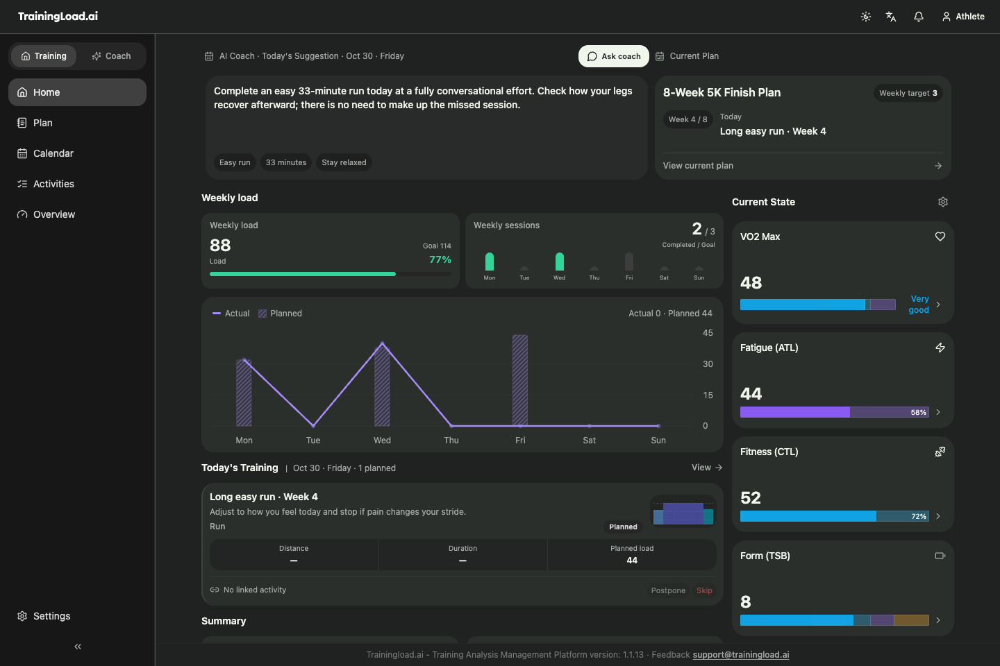
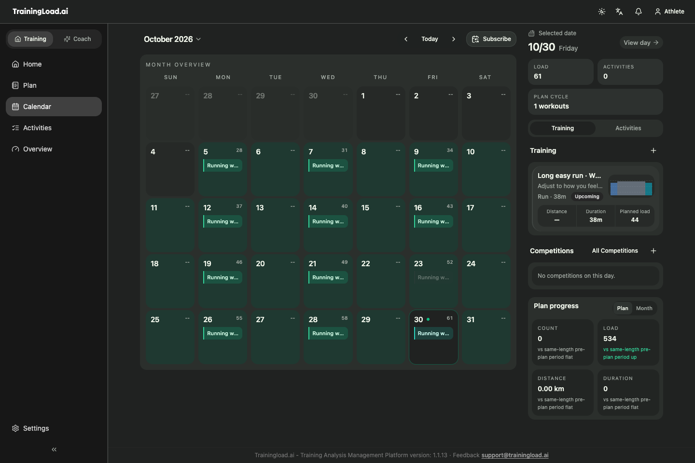
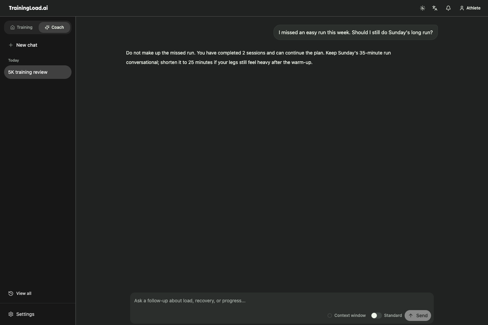
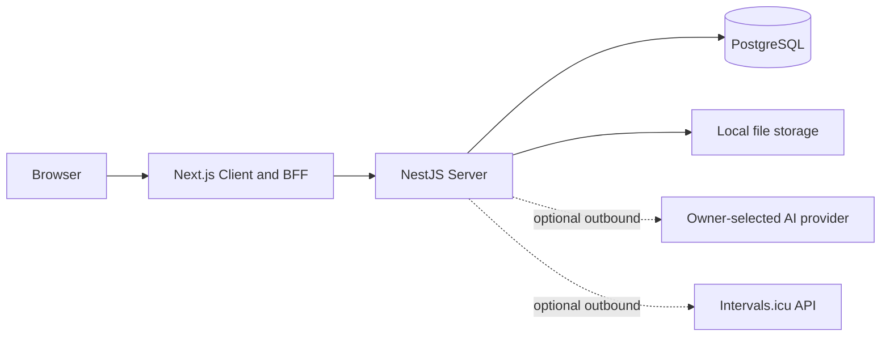

<p align="center">
  <picture>
    <source media="(prefers-color-scheme: dark)" srcset="apps/client/public/LOGO_DARK.svg">
    <source media="(prefers-color-scheme: light)" srcset="apps/client/public/LOGO_LIGHT.svg">
    
  </picture>
</p>

<h1 align="center">Trainingload.ai — Open-source training analysis and AI coaching</h1>

<p align="center">
  A self-hosted endurance training platform for runners, cyclists, and multi-sport athletes.
</p>

<p align="center">
  <a href="https://trainingload.ai">Website</a> ·
  <a href="https://trainingload.ai/docs">Documentation</a> ·
  <a href="SELF_HOSTING.md">Self-hosting</a> ·
  <a href="README_ZH.md">简体中文</a> ·
  <a href="LICENSE">AGPL-3.0-only</a>
</p>

> [!IMPORTANT]
> The public source and release pipeline are available, but the first signed Docker release bundle has not been published yet. Until it is published, the source workflow below is intended for evaluation and development rather than production installation.

## What is Trainingload.ai?

Trainingload.ai turns completed workouts into training context you can act on. Import FIT, TCX, or GPX files, connect an Intervals.icu account with a personal API key, inspect pace, heart-rate, power, route, and load data, then connect that evidence to a calendar and training plan.

The public edition is an **open-source, self-hosted training app**. Your structured data stays in your PostgreSQL instance, uploaded files stay on local storage, and official telemetry is disabled. The AI coach supports OpenAI, DeepSeek, OpenRouter, DashScope, and custom OpenAI-compatible services, with configurable API keys, base URLs, and models.

Trainingload.ai is designed around a complete training loop:

**plan → complete a workout → analyze the activity → review training load → confirm the next adjustment**

For athletes comparing an open-source, self-hosted alternative to TrainingPeaks, Intervals.icu, or Runalyze, Trainingload.ai focuses on combining running and cycling analysis, PMC-style load trends, planning, and an AI coach that connects to supported providers. Feature coverage is different, so review the [self-host boundaries](#self-host-boundaries) before migrating.

## Product preview

These screens are rendered from the current Self-host Client with deterministic sample data.



| Training calendar | AI coach |
| --- | --- |
|  |  |

## Key features

- **Activity import and analysis** — upload FIT, TCX, and GPX files; review GPS routes, laps, pace, heart rate, power, elevation, and derived metrics.
- **Training load and fitness trends** — follow TSS or TRIMP-based load, Intensity Factor, CTL, ATL, TSB, PMC-style trends, zones, thresholds, and effective VO2max context.
- **Plans, workouts, and calendar** — build and follow running, cycling, multi-sport, endurance, and strength plans; compare planned work with completed activities.
- **AI coach across supported providers** — connect OpenAI, DeepSeek, OpenRouter, DashScope, or a custom OpenAI-compatible endpoint for activity reviews, plan drafts, follow-up questions, and confirmable adjustments.
- **Evidence-based workflow** — recommendations can use athlete profile, activity history, current load, plan progress, and prior reviews instead of treating one metric as the full story.
- **Local data ownership** — training data stays in your own PostgreSQL database and uploaded files stay on your own server. You can export or delete account data at any time, with documented backup and restore workflows.
- **Open maps** — self-host includes activity route maps powered by MapLibre, with support for OpenFreeMap, OSM-compatible map services, and custom map configurations.
- **Internationalized product and docs** — the application and documentation include multiple locales, with English fallback where a translation is incomplete.

AI output is training guidance, not medical diagnosis. Training metrics are models and should be interpreted together with context and how you feel.

## Getting started

There are two ways to use Trainingload.ai:

| Option | Best for | What you manage |
| --- | --- | --- |
| [Managed Cloud](https://trainingload.ai) | The fastest way to start, hosted accounts, managed AI, and additional integrations | Your athlete profile and product settings |
| [Self-host](SELF_HOSTING.md) | Athletes who want local data ownership and direct connections to supported AI providers | Docker host, storage, secrets, backups, updates, and provider costs |

### Evaluate self-host from source

Requirements: Docker Engine or Docker Desktop with Compose v2, Node.js 22+, pnpm 9+, 2 CPU, 2 GiB RAM, and at least 5 GiB of free disk space.

```bash
corepack enable
pnpm install --frozen-lockfile

# Inspect the initialization plan, then create local secrets and data folders.
pnpm self-host -- init --dry-run --json
pnpm self-host -- init --json

# Inspect the Docker source-build plan, then build and start the complete stack.
pnpm self-host -- start --source --dry-run --json
pnpm self-host -- start --source --json
```

Open [http://localhost:43210](http://localhost:43210), enter your name, and complete onboarding. The default listener is `127.0.0.1`; keep it on loopback unless you provide an authenticated HTTPS reverse proxy.

The management CLI generates three independent instance secrets and never prints them. It starts PostgreSQL, a permission initializer, database migrations, Server, and Client. Docs and Caddy are not part of the runtime stack.

When signed releases become available, the recommended installation path will be the exact-version release bundle described in [SELF_HOSTING.md](SELF_HOSTING.md), with digest-pinned `linux/amd64` and `linux/arm64` images built by CI.

## Self-host architecture



The browser reaches one Client port. The Server and PostgreSQL stay on the private Compose network. Uploaded files use local storage, notifications stay in the application, and AI providers plus Intervals.icu are optional outbound connections.

### Self-host boundaries

| Area | Public self-host behavior |
| --- | --- |
| AI | OpenAI, DeepSeek, OpenRouter, DashScope, or a custom OpenAI-compatible service |
| Imports | FIT, TCX, GPX, and an Intervals.icu personal API key |
| Maps | MapLibre with OpenFreeMap, OSM-compatible, or custom map configuration |
| Storage | PostgreSQL plus local uploaded-file storage |
| Product access | Core training features and BYOK AI have no subscription, membership, or credit wall |
| Telemetry | Official telemetry is fixed off in the signed self-host configuration |
| Network | Loopback by default; remote exposure is an operator security decision |

See [known limitations](SELF_HOST_KNOWN_LIMITATIONS.md) before choosing a production topology.

## Self-host and Managed Cloud

Both editions use the same public training domain logic. Managed Cloud adds private hosted-service capabilities around it.

| Capability | Self-host | Managed Cloud |
| --- | --- | --- |
| Training features | Activities, metrics, plans, calendar, AI coaching, and reviews | Activities, metrics, plans, calendar, AI coaching, and reviews |
| AI | OpenAI, DeepSeek, OpenRouter, DashScope, or a custom OpenAI-compatible service | Managed models and commercial accounting |
| Data import | Files and Intervals.icu personal API key | Additional managed platform integrations |
| Storage and notifications | Local persistence and in-app behavior | Managed storage and messaging providers |
| Operations | You operate, back up, and upgrade the instance | Operated by Trainingload.ai |
| Commercial features | None | Subscription, membership, credits, gifts, and other hosted-service features |

## Repository layout

| Path | Purpose |
| --- | --- |
| `apps/client` | Next.js product UI and same-origin BFF |
| `apps/server` | NestJS API, training domain services, workers, and self-host entrypoint |
| `apps/docs` | Public documentation and training knowledge site; built separately |
| `packages/prisma` | Public Prisma schema, generated Client, and self-host migration lineage |
| `packages/messages` | Public client and server message catalogs |
| `packages/shared` | Shared training contracts, types, and plan templates |
| `scripts/selfhost` | Install, lifecycle, backup, restore, diagnostics, and release verification tools |
| `docker/selfhost` | Machine-readable image, Compose, and release contracts |

Managed Cloud, billing, memberships, AI credits, commercial operations, private provider implementations, Desktop, and Mobile are maintained outside this public repository.

## Development

```bash
corepack enable
pnpm install --frozen-lockfile
pnpm prisma:generate
pnpm boundary:check
pnpm messages:check
pnpm selfhost:inventory:check
pnpm build:selfhost
pnpm test:selfhost

# Regenerate the deterministic Self-host screenshots used in this README.
pnpm screenshots:readme
```

Build the documentation separately with `pnpm docs:build`. Running the product does not require the Docs application.

Public code must use declared package exports and must not depend on Managed Cloud modules. Self-host and Managed Cloud generate separate Prisma Clients and use separate migration histories.

## Documentation

- [Architecture and deployment composition](ARCHITECTURE.md)
- [Install and configure self-host](SELF_HOSTING.md)
- [Operate and troubleshoot an instance](SELF_HOST_OPERATIONS.md)
- [Known limitations](SELF_HOST_KNOWN_LIMITATIONS.md)
- [Back up and restore](BACKUP_RESTORE.md)
- [Upgrade and roll back](UPGRADE.md)
- [Get support](SUPPORT.md)

## Contributing, security, and license

Read [CONTRIBUTING.md](CONTRIBUTING.md) and the [Code of Conduct](CODE_OF_CONDUCT.md) before participating. Use [SUPPORT.md](SUPPORT.md) for product and deployment questions. Report vulnerabilities through the private process in [SECURITY.md](SECURITY.md), never through a public issue.

Trainingload.ai public code is licensed under [AGPL-3.0-only](LICENSE). External contributions are accepted under the same license. A separate written agreement is required before a contribution can be used under a separate commercial license.
