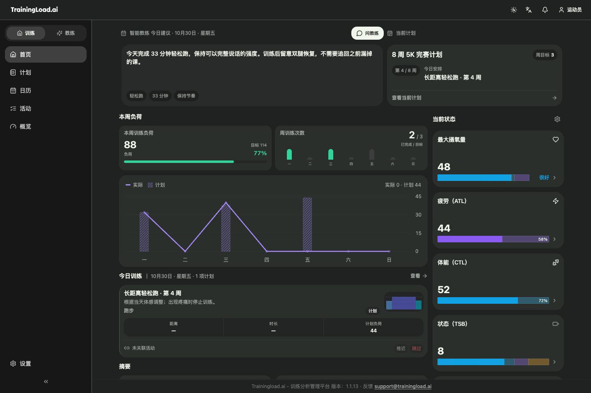
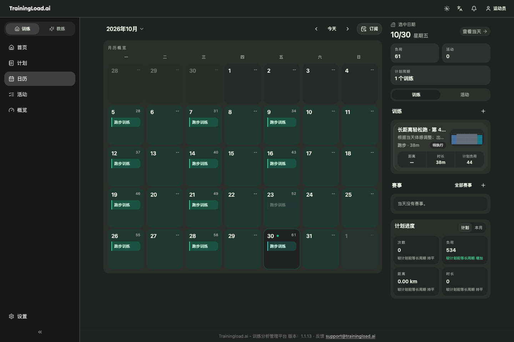
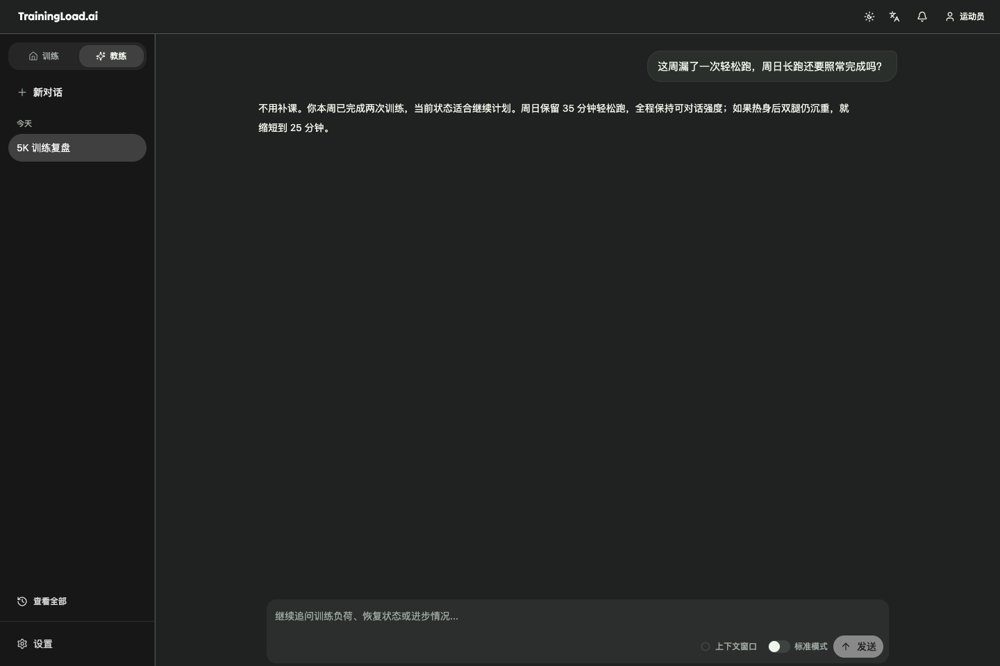
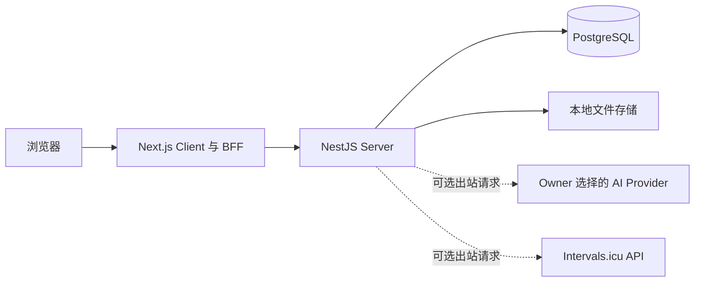

<p align="center">
  <picture>
    <source media="(prefers-color-scheme: dark)" srcset="apps/client/public/LOGO_DARK.svg">
    <source media="(prefers-color-scheme: light)" srcset="apps/client/public/LOGO_LIGHT.svg">
    
  </picture>
</p>

<h1 align="center">Trainingload.ai — 开源训练分析与 AI 教练</h1>

<p align="center">
  面向跑步、骑行与多项目运动员的自托管耐力训练平台。
</p>

<p align="center">
  <a href="https://trainingload.ai">网站</a> ·
  <a href="https://trainingload.ai/zh/docs">文档</a> ·
  <a href="SELF_HOSTING.md">自托管</a> ·
  <a href="README.md">English</a> ·
  <a href="LICENSE">AGPL-3.0-only</a>
</p>

> [!IMPORTANT]
> 公共源码与发行流水线已经具备，但首个签名 Docker 发行包尚未发布。在正式发行前，下方源码流程用于功能验收和开发，不应当作生产安装方式。

## Trainingload.ai 是什么？

Trainingload.ai 把已经完成的训练转化为可以采取行动的上下文。你可以导入 FIT、TCX、GPX 文件，使用个人 API Key 连接 Intervals.icu，查看配速、心率、功率、路线和训练负荷，再把这些真实证据连接到日历和训练计划中。

公共版本是一个**开源、自托管的训练应用**。结构化数据保存在你自己的 PostgreSQL 中，上传文件保存在本地，官方遥测默认关闭。AI 教练支持接入 OpenAI、DeepSeek、OpenRouter、阿里云百炼（DashScope）和自定义 OpenAI-compatible 服务，并可配置 API Key、Base URL 和模型。

Trainingload.ai 围绕一个完整训练闭环设计：

**制定计划 → 完成训练 → 分析活动 → 复核训练负荷 → 确认下一步调整**

如果你正在比较 TrainingPeaks、Intervals.icu 或 Runalyze 的开源、自托管替代方案，Trainingload.ai 的重点是把跑步与骑行分析、PMC 训练负荷趋势、训练计划和支持多个 Provider 的 AI 教练放在同一个工作流中。各产品的功能范围并不相同，迁移前请先阅读 [Self-host 产品边界](#self-host-产品边界)。

## 产品预览

以下界面由当前 Self-host Client 使用确定性的示例训练数据渲染。



| 训练日历 | AI 教练 |
| --- | --- |
|  |  |

## 核心能力

- **活动导入与分析**：上传 FIT、TCX、GPX，查看 GPS 路线、分段、配速、心率、功率、海拔和派生指标。
- **训练负荷与状态趋势**：追踪基于 TSS 或 TRIMP 的负荷、Intensity Factor、CTL、ATL、TSB、PMC 趋势、区间、阈值和 effective VO2max 上下文。
- **训练计划、课程与日历**：创建和执行跑步、骑行、多项目、耐力与力量训练计划，对比计划课程与真实完成活动。
- **支持多个 Provider 的 AI 教练**：可接入 OpenAI、DeepSeek、OpenRouter、DashScope 和自定义 OpenAI-compatible 接口，用于活动复盘、计划草稿、追问和需要确认的调整。
- **基于证据的训练工作流**：建议可以结合运动员资料、活动历史、当前负荷、计划进度和既往复盘，而不是把单一指标当成全部事实。
- **本地数据控制**：训练数据存储在你自己的 PostgreSQL 中，上传文件保存在你自己的服务器上；你可以随时导出或删除账号数据，并按文档完成备份与恢复。
- **开放地图**：Self-host 提供基于 MapLibre 的活动路线地图，支持 OpenFreeMap、兼容 OSM 的地图服务以及自定义地图配置。
- **多语言产品与文档**：应用和文档支持多个语言；翻译缺失时使用英文 fallback。

AI 输出属于训练建议，不是医疗诊断。训练指标都是模型，应结合上下文和真实身体感受一起判断。

## 开始使用

Trainingload.ai 有两种使用方式：

| 方式 | 适合谁 | 需要自己负责什么 |
| --- | --- | --- |
| [Managed Cloud](https://trainingload.ai) | 希望最快开始、使用托管账号、托管 AI 和更多平台连接 | 运动员资料和产品设置 |
| [Self-host](SELF_HOSTING.md) | 希望掌握本地数据并直接连接受支持 AI Provider 的运动员 | Docker 宿主、存储、密钥、备份、升级和 Provider 费用 |

### 从源码验收 Self-host

需要 Docker Engine 或 Docker Desktop + Compose v2、Node.js 22+、pnpm 9+、2 CPU、2 GiB 内存和至少 5 GiB 可用磁盘。

```bash
corepack enable
pnpm install --frozen-lockfile

# 先检查初始化计划，再生成本地密钥和数据目录。
pnpm self-host -- init --dry-run --json
pnpm self-host -- init --json

# 先检查 Docker 源码构建计划，再构建并启动完整服务。
pnpm self-host -- start --source --dry-run --json
pnpm self-host -- start --source --json
```

打开 [http://localhost:43210](http://localhost:43210)，输入你的名字并完成 onboarding。默认只监听 `127.0.0.1`；如果要远程访问，应自行提供带身份验证的 HTTPS 反向代理。

管理 CLI 会生成三个互相独立的实例密钥，并且不会输出密钥内容。运行栈包含 PostgreSQL、一次性权限初始化、数据库迁移、Server 和 Client；不包含 Docs 或 Caddy。

签名版本发布后，推荐使用 [SELF_HOSTING.md](SELF_HOSTING.md) 描述的精确版本 release bundle。CI 会为 `linux/amd64` 和 `linux/arm64` 构建并固定镜像 digest。

## Self-host 架构



浏览器只访问一个 Client 端口，Server 和 PostgreSQL 留在 Compose 私有网络中。上传文件使用本地存储，通知保留在应用内；AI Provider 与 Intervals.icu 都是可选的出站连接。

### Self-host 产品边界

| 区域 | 公共 Self-host 行为 |
| --- | --- |
| AI | 支持 OpenAI、DeepSeek、OpenRouter、DashScope 和自定义 OpenAI-compatible 服务 |
| 导入 | FIT、TCX、GPX 和 Intervals.icu 个人 API Key |
| 地图 | MapLibre，可使用 OpenFreeMap、兼容 OSM 的地图服务或自定义地图配置 |
| 存储 | PostgreSQL 与本地上传文件存储 |
| 产品访问 | 核心训练功能与 BYOK AI 没有订阅、会员或积分墙 |
| 遥测 | 签名 Self-host 配置固定关闭官方遥测 |
| 网络 | 默认只监听本机；远程暴露由部署者承担安全责任 |

决定生产部署拓扑前，请先阅读[已知限制](SELF_HOST_KNOWN_LIMITATIONS.md)。

## Self-host 与 Managed Cloud

两个版本复用相同的公共训练领域逻辑，Managed Cloud 在其外部增加私有托管能力。

| 能力 | Self-host | Managed Cloud |
| --- | --- | --- |
| 训练功能 | 活动、指标、计划、日历、AI 教练与复盘 | 活动、指标、计划、日历、AI 教练与复盘 |
| AI | 连接 OpenAI、DeepSeek、OpenRouter、DashScope 或自定义 OpenAI-compatible 服务 | 托管模型与商业结算 |
| 数据导入 | 文件与 Intervals.icu 个人 API Key | 更多托管平台连接 |
| 存储与通知 | 本地持久化与站内能力 | 托管存储和消息 Provider |
| 运维 | 自己运行、备份和升级 | 由 Trainingload.ai 运维 |
| 商业能力 | 无 | 订阅、会员、积分、赠送和其他托管服务能力 |

## 仓库结构

| 路径 | 作用 |
| --- | --- |
| `apps/client` | Next.js 产品界面与同源 BFF |
| `apps/server` | NestJS API、训练领域服务、Worker 与 Self-host 入口 |
| `apps/docs` | 公共产品文档与训练知识站，独立构建 |
| `packages/prisma` | 公共 Prisma schema、生成的 Client 与 Self-host migration lineage |
| `packages/messages` | 公共 Client 和 Server 词典 |
| `packages/shared` | 共享训练契约、类型与计划模板 |
| `scripts/selfhost` | 安装、生命周期、备份、恢复、诊断与发行验证工具 |
| `docker/selfhost` | 镜像、Compose 与发行流程的机器可读契约 |

Managed Cloud、Billing、会员、AI Credits、商业运营、私有 Provider 实现、Desktop 和 Mobile 均在此公共仓库之外维护。

## 开发

```bash
corepack enable
pnpm install --frozen-lockfile
pnpm prisma:generate
pnpm boundary:check
pnpm messages:check
pnpm selfhost:inventory:check
pnpm build:selfhost
pnpm test:selfhost

# 重新生成 README 使用的确定性 Self-host 产品截图。
pnpm screenshots:readme
```

文档使用 `pnpm docs:build` 单独构建。运行训练产品不需要启动 Docs。

公共代码必须通过声明的 package exports 使用依赖，不得依赖 Managed Cloud 模块。Self-host 与 Managed Cloud 分别生成 Prisma Client，并使用互相独立的 migration history。

## 文档

- [架构与部署组合](ARCHITECTURE.md)
- [安装与配置 Self-host](SELF_HOSTING.md)
- [实例运维与故障处理](SELF_HOST_OPERATIONS.md)
- [已知限制](SELF_HOST_KNOWN_LIMITATIONS.md)
- [备份与恢复](BACKUP_RESTORE.md)
- [升级与回滚](UPGRADE.md)
- [获取支持](SUPPORT.md)

## 贡献、安全与许可证

参与项目或提交 Pull Request 前，请阅读 [CONTRIBUTING.md](CONTRIBUTING.md) 和 [行为准则](CODE_OF_CONDUCT.md)。产品和部署问题见 [SUPPORT.md](SUPPORT.md)。安全漏洞必须按照 [SECURITY.md](SECURITY.md) 中的私密流程报告，不要发布到公开 Issue。

Trainingload.ai 公共代码使用 [AGPL-3.0-only](LICENSE)。外部贡献默认采用相同许可证。任何将外部贡献用于单独商业许可证的行为，都必须事先取得独立书面授权。
